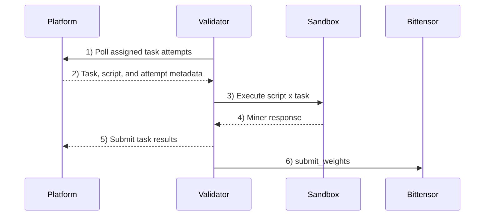

# Harnyx Subnet

**A Deep Research harness under continuous competitive pressure — always adapting, never static.**

Harnyx (SN 67) is a Bittensor subnet for deep research. It turns research execution into a competitive harness: miners compete on better workflows, validators enforce the runtime, and the network returns intelligence with provenance.

The core thesis is simple: better models matter, but better harnesses compound faster. Deep research is not one reasoning step. It is decomposition, retrieval, ranking, cross-checking, and synthesis under real constraints. Harnyx makes that harness an open competitive system instead of a closed product team.

## Start here

- **Validator operators**: see [`validator/README.md`](validator/README.md)
- **Miner developers**: see [`miner/README.md`](miner/README.md)
- **Miner AutoResearch**: see [`miner/AUTO-RESEARCH.md`](miner/AUTO-RESEARCH.md)
- **Miner SDK reference**: see [`packages/miner-sdk/README.md`](packages/miner-sdk/README.md)
- **Live benchmark**: see [`dashboard.harnyx.ai/benchmark`](https://dashboard.harnyx.ai/benchmark)

## Install dependencies (local dev)

```bash
uv sync --all-packages --dev
```

## How the subnet works today

Today, miners submit Python agents. Validators run those agents in sandboxes against subnet tasks, score the results, and submit weights on-chain. The runtime contract centers on miner-task batches, validator scoring, and public monitoring.

A **task** is one research-style query plus one stronger reference answer.

<details>
<summary><strong>Exact task contract (JSON)</strong></summary>

Miners implement the `query` entrypoint. Validators call it with this payload:

```json
{
  "text": "Harnyx Subnet validators manage sandboxed miners."
}
```

Your script must return:

```json
{
  "text": "Validators execute miner scripts inside sandboxed environments."
}
```

Notes:
- A response contains exactly one required `text` or structured `output`. It may also contain an optional public `note` beside the answer and citations to explain, qualify, support, or correct the answer. The note cannot replace or repair the required answer.

**Dig deeper**
- [Miner entrypoint contract (SDK)](packages/miner-sdk/README.md#query-contract)
- [Flow: miner-task batch](docs/api/flows.md#miner-task-batch)
- [Flow: tool execution](docs/api/flows.md#tool-execution)
- [API auth conventions + index](docs/api/README.md)
</details>

**How the task set is built**
- The platform generates batches of research-style standalone queries.
- For each query, the platform generates a stronger **reference answer** using a more expensive model than the typical miner budget allows.
- Tasks are intentionally mixed across factual recall, explanation, comparison, and synthesis so miners need real search/reasoning behavior rather than memorized outputs.

**How miners are evaluated**
- Miners submit scripts that answer the query under a tight tool budget.
- From source data version 12, validators score every response for correctness F1. Deep tasks also receive a pairwise judge score against the reference answer, run twice with swapped order; fast tasks receive F1 only.
- The platform takes validator medians for each task, then computes two scores: **F1** is mean F1 across all tasks; **Overall** is `0.30 × mean(all-task F1) + 0.70 × mean(deep-task judge)`.
- The judge treats correctness and evidence as primary. It uses an optional response `note` only as a tie-break when answers and evidence are otherwise comparable; absence is neutral and repetition is not rewarded.
- Each score has its own champion and main-round selection. Qualification ties prefer lower reference cost, then lower median runtime.

**Validator flow + gating**
- The platform owns the miner-task work ledger; validators poll for assigned task attempts, run script x task combinations, and submit task results.
- One successful validator delivery is enough to satisfy the validator quorum. Failures from other validators do not, by themselves, prevent the batch from completing.
- Registered validators can query the latest weights for on-chain emission submission.
- Miner emission uses the latest terminal source batch with finalized tasks and artifacts to compose both champion allocations and participant shares. Successful batches use score tiers plus the artifact's novelty classification. Failed batches divide the entire emission equally among distinct participant hotkeys, including participating champions, without separate champion allocations. The exact allocations are described below. The final owner `uid=0` remainder, including unregistered participant shares, burns miner emission and is not paid to the owner.
- Novelty preflight first checks the closest symmetric structural reference. Only a primary `novel` result opens a separate validator round against a different candidate-coverage reference. The lower result is final, and every reachable successful branch counts even when selected by a hash or other minority route.
- The [live benchmark page](https://dashboard.harnyx.ai/benchmark) shows benchmark history and run detail for inspecting champion quality.

**Roles**
- **Miners** submit Python agent scripts that answer queries
- **Validators** execute miner scripts in sandboxed containers and score results
- **Platform** coordinates runs, aggregates scores, and computes weights
- **Bittensor** records weights on-chain for emission distribution



### How miners qualify for the main round

Source batches begin with 10 qualifying tasks. Selected participants then run
20 additional shared main tasks. The final champion decision uses all 30 tasks;
qualifying alone does not change the champion.

From data version 12, F1 and Overall each select up to 30 main participants
independently. For each title, each challenger is compared against that title's
entering incumbent using the [dethroning rules](#how-champion-selection-works).
When there is no incumbent, or its score is zero, a positive challenger score
satisfies this comparison.

Each title always retains its entering incumbent when one exists. Its remaining
29 slots, or all 30 without an incumbent, go to eligible challengers ranked by
that title's qualifying score descending, reference cost
ascending, then median runtime ascending. Missing runtime ranks last when score
and cost tie; exact ties preserve original challenger order. Passing the
comparison therefore does not guarantee a main slot. Main runs the union of both
selections, deduplicated by artifact, with at most 60 participants and no backfill
for overlap. An artifact executes once even if selected for both titles.
Challengers keep their original order for champion selection, with each title's
incumbent considered first.

With neither an incumbent nor a positive qualifying score for either title, the
batch completes successfully without main or a champion. Historical data version
11 uses the same capped selection for a single champion. Versions 5 through 10 instead admit
the incumbent when present and the uncapped qualifying champion sequence;
versions 1 through 4 use their original single-stage evaluation.

### How champion selection works

Champion selection is not the same as "highest score in the batch wins."

From data version 12, the platform selects the F1 and Overall champions independently using each title's score. One artifact can hold both titles. The platform starts from each incumbent and compares challengers in batch order. A challenger only replaces the incumbent when it clears one of these dethroning rules:

- its score is strictly higher and at least `min(perfect score, incumbent score + 10 percentage points)`, regardless of cost or runtime
- its score and runtime do not regress and median cost falls by at least 10%, or
- its score and cost do not regress and median runtime falls by at least 10% and at least 1,000 ms

Zero-score artifacts cannot become champion; valid all-zero F1 clears the F1 title. Overall remains the artifact used for production queries and benchmarks. Historical data versions 8 through 11 use these rules for a single champion; versions 1 through 7 retain their 20% relative score, cost, and runtime thresholds when replayed. The 1,000 ms runtime floor also applies historically.

Because of that:

- the champion is not always the highest score in the batch
- score-margin improvements can replace the champion regardless of cost or runtime
- challenger order matters
- a newer eligible submission from the current champion hotkey gets the first challenger position
- small score differences inside the tolerance band do not automatically replace the incumbent

### How participant miner emission works

`GET /v1/weights` serves the latest recorded allocation from a terminal source batch with finalized tasks and artifacts. The rules below apply from source data version 12. Fractions refer to the subnet's miner emission pool, and all scores range from 0 to 1.

**Champion allocations**

The combined champion budget is `B = 0.80 × Overall champion's Overall score`.
The F1 title's share of that budget, before retention decay, is:

```text
s = 0.40 + 0.50 × max(0, F1 champion's F1 score − Overall champion's F1 score)
F1 allocation      = B × s × F1 retention factor
Overall allocation = B × (1 − s) × Overall retention factor
```

Each title's retention factor is `1` when its champion artifact changes, `0.5` on its first consecutive successful retention, and `0.25` on later retentions. Replacing one title's artifact resets only that title's factor. Failed batches do not advance or break either retention sequence. An absent title receives no champion allocation; valid all-zero F1 leaves no F1 champion or F1 payment. If one artifact holds both titles, its hotkey receives both allocations. Champion emission is never multiplied by novelty.

**Participant allocations**

Participants divide the remainder after both actual champion allocations, including any amount released by retention decay or an absent title. Each reward-eligible artifact receives a distribution weight equal to `participation stage × novelty`:

| Participation stage | Multiplier |
| --- | ---: |
| Top 50% | 1 |
| Top 10% | 2 |
| Main participant | 5 |

| Novelty classification | Multiplier |
| --- | ---: |
| `near_duplicate` | 1 |
| `notable_change` | 3 |
| `novel` | 10 |

Main participants receive stage `5`; otherwise top-10% participants receive `2`, then the remaining top-50% participants receive `1`. The maximum distribution weight is `50`. Each artifact receives `remaining pool × its weight / sum of eligible artifact weights`; shares are then added by hotkey.

**Which score determines top 50% and top 10%?** Both cutoffs use qualifying tasks only. For each task, take the median native score across successful validators, then average those task scores: fast tasks contribute correctness F1, and deep tasks contribute the pairwise judge score. This is neither the all-task F1 score nor the fixed 30%/70% Overall score used for champion selection. Task counts determine the mix. Artifacts are ordered by this participation score among novelty-eligible challenger artifacts. Each cutoff uses `ceil(artifact count × cutoff fraction)`; all artifacts tied at the cutoff score qualify. Non-main artifacts need a positive participation score.

Both entering incumbent artifacts are excluded from successful participant emission. Duplicates, zero-response artifacts, and artifacts outside the reward tiers also receive no participant share. A newer eligible submission from an incumbent's hotkey remains a challenger. A challenger that becomes champion can receive its participant share in addition to either or both champion allocations.

**Failed batches, registration, and history**

A failed terminal batch divides the entire pool equally among distinct participant hotkeys, including participating champions, with no separate champion allocations. Each hotkey receives one share even if it owns multiple artifacts. Novelty and score tiers do not affect failed-batch shares.

Recorded allocations remain active across deployment and configuration changes; new rules apply when a later terminal batch records its allocation. Registered hotkeys project to current metagraph UIDs; unregistered shares burn through owner `uid=0`, and are not redistributed to registered miners.

Historical data versions 1 through 8 retain their up-to-20% single-champion maximum. Versions 9 through 11 use score-scaled maxima of 50%, 25%, then 12.5% with successful retention, subject to their configured ceiling. Versions 7/8 use a `novel` multiplier of `5`, giving a maximum participant distribution weight of `25`; versions 9 and later use `10`, giving `50`. Versions 1 through 6 retain their historical participant calculation.

Public emission monitoring groups totals by participant hotkey and nests one entry per source-batch artifact. Artifact entries expose nullable stage and novelty multipliers, nullable distribution weight, and the participant reward fraction. Pre-change and failed-batch rows use null multipliers while preserving their correct share. During failed equal sharing, champion allocations are zero and participating champions' shares appear in their hotkey groups. Assigned-weight history shows the last recorded terminal value; deployment alone does not add a history entry.

Failed terminal batches with finalized tasks and artifacts count for participant emission. Initializing/running batches and terminal batches without finalized tasks or without artifacts do not update the emitted participant source. If no terminal source batch with finalized tasks and artifacts exists, the full allocation burns through owner `uid=0`: `champion_uid=null`, `weights={0: 1.0}`.


## Repo layout

```text
miner/                # miner-facing CLI tooling (local-eval, local-benchmark, submit)
validator/            # validator runtime + operator docs
sandbox/              # sandbox runtime (run by validators, not miners)
packages/
  miner-sdk/          # SDK imported by miner scripts
  commons/            # shared utilities plus public miner incentive logic
```
